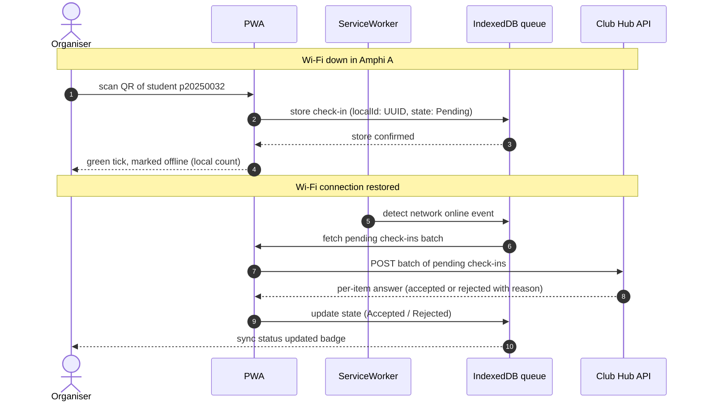

# Institute of Technology of Cambodia
### Lab Report

| Info | Details |
| --- | --- |
| **Course** | Introduction to Software Engineering |
| **Author** | Song Vansak |
| **Instructor** | Tal Tongsreng |
| **Date** | 11/04/2026 |
| **Project** | ITC Club Hub · clubhub-ISE-4G |
| **Lab branch snapshot** | `lab-02` at `a5b74f4` |

---

## REPORT

#### File: `ISE-4G-Report-Lab02.md`
# ISE-4G Project File Guide — Lab 02

**Revision:** 1.0

This report follows the Lab 01 report as a model. It summarizes the Lab 02 tasks, records the repository layout and implementation status, and includes the complete text of the relevant project documents and source files. It reflects the repository snapshot on November 4, 2026.

## Executive summary

Lab 02 extends the ITC Club Hub project from team planning and a small C++ starter into application classification, an application-type decision, quality attribute scenarios, architecture diagrams, and an event-listing C++ command-line program. The optional challenge describes offline check-in and provides a C++ queue interface.

The team classified ABA Mobile, Telegram, a car ABS controller, Moodle at ITC, and Roblox. The application-type ADR compares four options and recommends a PWA with responsive web screens. Its approval state needs careful reading: the ADR header says “Approved” and records client approval on November 4, while the decision log still says instructor/TA review is pending. This report describes Option B as client-approved, with academic review still pending according to the decision log.

The quality scenarios cover availability, check-in performance, usability, security, modifiability, and portability. QAS-01 and QAS-02 are marked as first priorities. The challenge adds a seventh offline-resilience scenario and describes conflict handling and idempotent synchronization.

The implemented C++ scope contains an `Event` domain class, a CSV loader, and a `list-events` CLI. The Visual Studio build output supplied with the project shows the executable at `build/Debug/clubhub.exe`. The optional check-in header declares queue types and operations; its methods are not implemented or included in the CMake targets.

## Repository snapshot and scope

The report is based on branch `lab-02`, commit `a5b74f4` (“Approval”). Generated build output and Git metadata are omitted from the project tree.

```text
clubhub-ISE-4G/
├── README.md
├── ISE-4G-Report-Lab02.md
├── .gitignore
├── LICENSE
├── CMakeLists.txt
├── .vscode/
│   └── tasks.json
├── data/
│   └── events.csv
├── include/
│   └── clubhub/
│       ├── event.hpp
│       ├── event_csv.hpp
│       └── queued_checkin.hpp
├── src/
│   ├── event.cpp
│   ├── event_csv.cpp
│   └── cli/
│       └── main.cpp
├── lab01/
│   ├── .gitkeep
│   ├── decisions.md
│   └── team-charter.md
└── lab02/
    ├── README.md
    ├── app-classification.md
    ├── app-quadrant.mmd
    ├── adr-001-application-type.md
    ├── quality-scenarios.md
    ├── context-diagram.mmd
    ├── context-diagram.png
    ├── architecture.mmd
    ├── architecture.png
    └── challenge/
        └── offline-checkin.md
```

The PNG assets are present and embedded by the Lab 02 README. The report includes the Mermaid source files as source; it does not assert that the PNG files were generated by a Mermaid renderer.

## Contents

- [Task 1: Application classification](#task-1-application-classification)
- [Task 2: Application type decision](#task-2-application-type-decision)
- [Task 3: Quality attribute scenarios](#task-3-quality-attribute-scenarios)
- [Task 4: Context and architecture diagrams](#task-4-context-and-architecture-diagrams)
- [Task 5: C++ core and CLI](#task-5-c-core-and-cli)
- [Challenge: Offline-first check-in](#challenge-offline-first-check-in)
- [Build and execution notes](#build-and-execution-notes)
- [Inputs reused from Lab 01](#inputs-reused-from-lab-01)
- [File inventory](#file-inventory)
- [Complete file contents](#complete-file-contents)

## Task 1: Application classification

The classification table applies software engineering terms to five applications: ABA Mobile, Telegram, an automotive ABS controller, Moodle at ITC, and Roblox. For each, it records the kind and type of software, where it runs and how it is delivered, its architecture, three important quality attributes, and the person who filled the row. The quadrant source places the five applications by timing demand and availability demand.

The key comparison in the submission is that an ABS controller is embedded software with time-critical safety consequences, while the other examples are user-facing applications whose principal consequences are interruption or delay to banking, communication, study, or play.

## Task 2: Application type decision

ADR-001 compares native applications, a PWA with responsive web screens, responsive web only, and a cross-platform mobile application plus web administration. It scores each option against cost, reach, offline check-in, reminders, and administration/reporting. Option B receives the highest total score and is recommended because it pairs broad device reach with a local queue for check-in during a venue network outage.

The repository records client approval on November 4. However, the ADR header, its review instructions, and the decision log do not use the same approval state. The decision log’s November 3 entry says instructor/TA review and acceptance are pending; its November 4 entry records client approval, but places that text in the alternatives column and lists “Teacher” as the decider. The report preserves this distinction rather than treating client approval as documented instructor/TA acceptance.

## Task 3: Quality attribute scenarios

The quality-scenarios file contains six structured scenarios. Each uses the source, stimulus, environment, artifact, response, and response-measure fields. The priority table marks availability (QAS-01) and door check-in performance (QAS-02) as first priorities. The check-in scenario explicitly makes offline queue behavior conditional on approval of ADR-001 Option B. QAS-06 also describes its browser targets as provisional.

## Task 4: Context and architecture diagrams

The context diagram places ITC Club Hub between students, club leaders, organisers, administrators, the e-mail service, and the ITC student directory. The architecture diagram sketches presentation, logic, data, and external systems, distinguishing the CLI and C++ core from a proposed, modelled PWA.

The architecture sketch names `RegistrationService` and `EventService`, but the current C++ project implements an `Event` model and CSV loading rather than those service classes. The challenge queue header is also declaration-only and is not part of the CMake build. These are useful scope boundaries to keep clear when describing the architecture.

## Task 5: C++ core and CLI

The C++20 core defines `Event`, parses and formats minute-precision event times, and loads event records from CSV while preserving valid rows when another row is malformed. The CLI sorts valid events and prints them with any parse errors. The sample dataset deliberately includes `E004` with capacity zero, which violates the `Event` constructor rule and is reported as a skipped row.

The supplied build log shows CMake configured with the Visual Studio generator and built `clubhub.exe` under `build/Debug/`. Therefore, `./build/clubhub` is not the executable path for that configuration.

## Challenge: Offline-first check-in

The challenge describes an organiser scanning a student QR code while disconnected, saving a pending check-in in IndexedDB, and synchronizing it when connectivity returns. Its conflict table covers duplicate scans, cancelled registrations, unregistered students, retry after timeout, and device-clock skew. It also proposes a UUID `localId` for idempotent retries and defines QAS-07 for an outage during a busy arrival period.

The document describes a PWA/API workflow. The C++ `queued_checkin.hpp` file supplies corresponding data types and method declarations, but no method implementation is currently compiled into the project.

## Build and execution notes

The user-provided build output reports that configuration and compilation succeeded with the Visual Studio 2022 generator and produced:

```text
build/Debug/clubhub.exe
```

For Git Bash, run:

```bash
./build/Debug/clubhub.exe list-events data/events.csv
```

For PowerShell, run:

```powershell
.\build\Debug\clubhub.exe list-events data/events.csv
```

With a single-configuration generator such as Ninja or Unix Makefiles, the executable is normally at `build/clubhub` on Unix-like systems, or `build/clubhub.exe` on Windows. The sample CSV contains an intentional invalid row (`E004`, capacity `0`), so the CLI reports the valid events and a skipped row; its exit status is nonzero when it reports that data error. The pasted output demonstrates a successful build but does not show a successful run using the corrected executable path.

## Inputs reused from Lab 01

| Reused file | Use in Lab 02 |
| --- | --- |
| `lab01/team-charter.md` | Carries the team roles, working agreements, and decision rules into the next lab. |
| `lab01/decisions.md` | Provides the team decision log and links to ADR-001. |

The Lab 02 README also records commit identifiers for the reused Lab 01 files. The decision log is relevant to the ADR status note above.

## File inventory

| File | Purpose |
| --- | --- |
| `README.md` | Repository identity and team roles. |
| `ISE-4G-Report-Lab02.md` | This report and file guide. |
| `.gitignore` | Ignores generated build files and common development artifacts. |
| `LICENSE` | States that the team will choose a license in Lab 03. |
| `CMakeLists.txt` | Defines the C++20 core library and CLI executable. |
| `.vscode/tasks.json` | Editor task configuration. |
| `data/events.csv` | Sample event data, including one intentionally invalid record. |
| `include/clubhub/event.hpp` | Declares the event model and time conversion functions. |
| `include/clubhub/event_csv.hpp` | Declares CSV parse results and the loader interface. |
| `include/clubhub/queued_checkin.hpp` | Declares offline check-in data and queue operations. |
| `src/event.cpp` | Implements event validation and date-time conversion. |
| `src/event_csv.cpp` | Implements line-by-line CSV loading and error collection. |
| `src/cli/main.cpp` | Implements the `list-events` command. |
| `lab01/team-charter.md` | Reused team agreements. |
| `lab01/.gitkeep` | Keeps the Lab 01 directory present. |
| `lab01/decisions.md` | Reused decision log and ADR pointer. |
| `lab02/app-classification.md` | Classification table for five applications. |
| `lab02/app-quadrant.mmd` | Mermaid quadrant chart source. |
| `lab02/adr-001-application-type.md` | Weighted application-type decision record. |
| `lab02/quality-scenarios.md` | Six quality attribute scenarios and priorities. |
| `lab02/context-diagram.mmd` | Mermaid system context diagram source. |
| `lab02/context-diagram.png` | Context diagram image asset referenced by the README. |
| `lab02/architecture.mmd` | Mermaid three-tier architecture source. |
| `lab02/architecture.png` | Architecture image asset referenced by the README. |
| `lab02/challenge/offline-checkin.md` | Offline sequence, conflict rules, idempotency explanation, and QAS-07. |
| `lab02/README.md` | Lab summary, images, inventory, reused inputs, build commands, and change log. |

## Complete file contents

The following sections reproduce the relevant repository text and source files as they existed in the report snapshot. Image files are listed in the inventory and remain available separately in `lab02/`.

### File: `README.md`

The repository README identifies the project and lists team roles.

````markdown
# ITC Club Hub · clubhub-ISE-4G (v0.1.0, 10/21/2026)

## Members and roles

| Member              | GitHub              | Role (Sprint 1) | Shared hat       |
| ------------------- | ------------------- | --------------- | ---------------- |
| Keo Vimeanrathbosba | @keovimeanrathbosba | Product Owner   | Business-Analyst |
| Song Vansak         | songvansak19        | Scrum Master    | Organizer        |
| Lor Hengleap        | KageKishi           | Developer       | DevOps           |
| Sreu Visal          | visal-rg            | Developer       | Tester           |
````

### File: `.gitignore`

The ignore file includes the project build directory and common generated files.

````gitignore
#=============ACTUAL LAB01============
#Build
build/

# .vscode
.vscode
#=====================================

#======== GITHUB BUNS IGNORED BUILT IN=============
# Logs
logs
*.log
npm-debug.log*
yarn-debug.log*
yarn-error.log*
lerna-debug.log*

# database
*.sqlite

# package-json
package-json.lock

# bun deploy file
node_modules.bun

# Diagnostic reports (https://nodejs.org/api/report.html)
report.[0-9]*.[0-9]*.[0-9]*.[0-9]*.json

# Runtime data
pids
*.pid
*.seed
*.pid.lock

# Directory for instrumented libs generated by jscoverage/JSCover
lib-cov

# Coverage directory used by tools like istanbul
coverage
*.lcov

# nyc test coverage
.nyc_output

# Grunt intermediate storage (https://gruntjs.com/creating-plugins#storing-task-files)
.grunt

# Bower dependency directory (https://bower.io/)
bower_components

# node-waf configuration
.lock-wscript

# Compiled binary addons (https://nodejs.org/api/addons.html)
build/Release

# Dependency directories
node_modules/
jspm_packages/

# TypeScript v1 declaration files
typings/

# TypeScript cache
*.tsbuildinfo

# Optional npm cache directory
.npm

# Optional eslint cache
.eslintcache

# Microbundle cache
.rpt2_cache/
.rts2_cache_cjs/
.rts2_cache_es/
.rts2_cache_umd/

# Optional REPL history
.node_repl_history

# Output of 'npm pack'
*.tgz

# Yarn Integrity file
.yarn-integrity

# dotenv environment variables file
.env
.env.test

# parcel-bundler cache (https://parceljs.org/)
.cache

# Next.js build output
.next

# Nuxt.js build / generate output
.nuxt
dist

# Gatsby files
.cache/
# Comment in the public line in if your project uses Gatsby and *not* Next.js
# https://nextjs.org/blog/next-9-1#public-directory-support
# public

# vuepress build output
.vuepress/dist

# Serverless directories
.serverless/

# FuseBox cache
.fusebox/

# DynamoDB Local files
.dynamodb/

# TernJS port file
.tern-port
#==========================================
````

### File: `LICENSE`

The license placeholder defers license selection to Lab 03.

````text
All rights reserved until the team chooses a license (Lab-03).
````

### File: `CMakeLists.txt`

The CMake configuration sets C++20, builds the core library, and links the CLI.

````cmake
cmake_minimum_required(VERSION 3.28)
project(clubhub LANGUAGES CXX)

set(CMAKE_CXX_STANDARD 20)
set(CMAKE_CXX_STANDARD_REQUIRED ON)
set(CMAKE_CXX_EXTENSIONS OFF)

# Core: domain model and rules. No console, no file names.
add_library(clubhub_core src/event.cpp src/event_csv.cpp)
target_include_directories(clubhub_core PUBLIC include)

# Interface: the command-line front end. A web or mobile front end
# would be another target that links the same core.
add_executable(clubhub src/cli/main.cpp)
target_link_libraries(clubhub PRIVATE clubhub_core)
````

### File: `data/events.csv`

The sample dataset includes four valid rows and one intentionally invalid row.

````csv
id,title,start,location,capacity
E001,Robotics Workshop,2026-10-14 14:00,Lab F-301,30
E002,Debate Night,2026-10-16 18:00,Amphi A,120
E003,Intro to Git,2026-10-09 15:30,Room I-204,40
E004,Charity Run Briefing,2026-10-21 17:00,Sports Hall,0
E005,Photo Walk,2026-10-18 07:00,Main Gate,25
````

### File: `include/clubhub/event.hpp`

The public Event model interface and time conversion declarations.

````cpp
// include/clubhub/event.hpp
#pragma once
#include <chrono>
#include <string>

namespace clubhub {

// Minute precision is enough for club events. Times are ITC local
// time (Asia/Phnom_Penh); this lab does no time-zone conversion.
using TimePoint = std::chrono::sys_time<std::chrono::minutes>;

class Event {
public:
    // Throws std::invalid_argument when a field breaks a rule.
    Event(std::string id, std::string title, TimePoint start,
          std::string location, int capacity);

    const std::string& id() const noexcept { return id_; }
    const std::string& title() const noexcept { return title_; }
    TimePoint start() const noexcept { return start_; }
    const std::string& location() const noexcept { return location_; }
    int capacity() const noexcept { return capacity_; }

    // Business rule: events in the past cannot be registered for.
    bool hasStarted(TimePoint now) const noexcept { return start_ <= now; }

private:
    std::string id_;
    std::string title_;
    TimePoint start_;
    std::string location_;
    int capacity_;
};

// "2026-10-14 14:00" -> TimePoint; throws std::invalid_argument
TimePoint parseTimePoint(const std::string& text);

// TimePoint -> "2026-10-14 14:00"
std::string formatTimePoint(TimePoint t);

} // namespace clubhub
````

### File: `include/clubhub/event_csv.hpp`

CSV error/result structures and the loader declaration.

````cpp
// include/clubhub/event_csv.hpp
#pragma once
#include <istream>
#include <string>
#include <vector>

#include "clubhub/event.hpp"

namespace clubhub {

struct CsvError {
    int line;
    std::string message;
};

struct EventLoadResult {
    std::vector<Event> events;
    std::vector<CsvError> errors;
};

// Reads "id,title,start,location,capacity" rows after one header line.
// A bad row goes to errors; the good rows are still returned.
EventLoadResult loadEventsCsv(std::istream& in);

} // namespace clubhub
````

### File: `include/clubhub/queued_checkin.hpp`

Offline check-in state types and queue operation declarations; these methods are not implemented in the current build.

````cpp
#pragma once

#include <chrono>
#include <optional>
#include <string>
#include <vector>

namespace clubhub
{

    enum class SyncState
    {
        Pending,
        Sent,
        Accepted,
        Rejected
    };

    // One check-in recorded on an organiser's phone while offline.
    struct QueuedCheckIn
    {
        std::string localId; // UUID generated on device (ensures idempotency)
        std::string deviceId;
        std::string eventId;
        std::string studentId;
        std::chrono::time_point<std::chrono::system_clock, std::chrono::seconds> scannedAt; // device clock timestamp
        int attempts = 0;
        SyncState state = SyncState::Pending;
        std::optional<std::string> rejectReason;
    };

    class CheckInQueue
    {
    public:
        // false if this student is already queued for this event
        bool enqueue(QueuedCheckIn item);
        // oldest first; what the next sync attempt uploads
        std::vector<QueuedCheckIn> pending() const;
        void markAccepted(const std::string &localId);
        void markRejected(const std::string &localId, std::string reason);

    private:
        std::vector<QueuedCheckIn> items_;
    };

} // namespace clubhub
````

### File: `src/event.cpp`

Event validation, ISO-like date-time parsing, and formatting implementation.

````cpp
#include "clubhub/event.hpp"
#include <chrono>
#include <iomanip>
#include <sstream>
#include <stdexcept>
#include <utility>

namespace clubhub
{

    namespace
    {
        // Days since 1970-01-01, using the proleptic Gregorian calendar.
        long long daysFromCivil(int year, unsigned month, unsigned day)
        {
            year -= month <= 2;
            const int era = (year >= 0 ? year : year - 399) / 400;
            const unsigned yearOfEra = static_cast<unsigned>(year - era * 400);
            const unsigned dayOfYear =
                (153 * (month + (month > 2 ? -3 : 9)) + 2) / 5 + day - 1;
            const unsigned dayOfEra = yearOfEra * 365 + yearOfEra / 4 -
                                      yearOfEra / 100 + dayOfYear;
            return static_cast<long long>(era) * 146097 + dayOfEra - 719468;
        }

        void civilFromDays(long long days, int &year, unsigned &month,
                           unsigned &day)
        {
            days += 719468;
            const long long era = (days >= 0 ? days : days - 146096) / 146097;
            const unsigned dayOfEra =
                static_cast<unsigned>(days - era * 146097);
            const unsigned yearOfEra =
                (dayOfEra - dayOfEra / 1460 + dayOfEra / 36524 -
                 dayOfEra / 146096) /
                365;
            year = static_cast<int>(yearOfEra) + static_cast<int>(era) * 400;
            const unsigned dayOfYear =
                dayOfEra - (365 * yearOfEra + yearOfEra / 4 - yearOfEra / 100);
            const unsigned monthPart = (5 * dayOfYear + 2) / 153;
            day = dayOfYear - (153 * monthPart + 2) / 5 + 1;
            month = monthPart + (monthPart < 10 ? 3 : -9);
            year += month <= 2;
        }
    }

    Event::Event(std::string id, std::string title, TimePoint start,
                 std::string location, int capacity)
        : id_{std::move(id)}, title_{std::move(title)}, start_{start},
          location_{std::move(location)}, capacity_{capacity}
    {
        if (id_.empty())
        {
            throw std::invalid_argument{"id cannot be empty"};
        }
        if (title_.empty())
        {
            throw std::invalid_argument{"title cannot be empty"};
        }
        if (capacity_ <= 0)
        {
            throw std::invalid_argument{"capacity must be positive"};
        }
    }

    TimePoint parseTimePoint(const std::string &text)
    {
        using namespace std::chrono;
        std::istringstream in{text};
        int y{}, mo{}, d{}, h{}, mi{};
        char dash1{}, dash2{}, colon{};
        in >> y >> dash1 >> mo >> dash2 >> d >> h >> colon >> mi;

        if (!in || dash1 != '-' || dash2 != '-' || colon != ':')
        {
            throw std::invalid_argument{"bad date-time '" + text + "'"};
        }

        char extra{};
        if (in >> extra)
        {
            throw std::invalid_argument{"bad date-time '" + text + "'"};
        }

        if (mo < 1 || mo > 12 || d < 1 || h < 0 || h > 23 || mi < 0 ||
            mi > 59)
        {
            throw std::invalid_argument{"bad date-time '" + text + "'"};
        }

        const auto nextMonth = mo == 12 ? 1 : mo + 1;
        const auto nextMonthYear = mo == 12 ? y + 1 : y;
        const auto daysInMonth =
            daysFromCivil(nextMonthYear, static_cast<unsigned>(nextMonth), 1) -
            daysFromCivil(y, static_cast<unsigned>(mo), 1);
        if (d > static_cast<int>(daysInMonth))
        {
            throw std::invalid_argument{"bad date-time '" + text + "'"};
        }

        const auto totalMinutes =
            daysFromCivil(y, static_cast<unsigned>(mo), static_cast<unsigned>(d)) *
                1440LL +
            h * 60LL + mi;
        return TimePoint{minutes{totalMinutes}};
    }

    std::string formatTimePoint(TimePoint t)
    {
        const auto totalMinutes = t.time_since_epoch().count();
        const auto days = totalMinutes >= 0
                              ? totalMinutes / 1440
                              : (totalMinutes - 1439) / 1440;
        const auto minutesOfDay = totalMinutes - days * 1440;
        int year{};
        unsigned month{}, day{};
        civilFromDays(days, year, month, day);
        std::ostringstream out;
        out << std::setfill('0') << year << '-' << std::setw(2) << month << '-'
            << std::setw(2) << day << ' ' << std::setw(2)
            << minutesOfDay / 60 << ':' << std::setw(2) << minutesOfDay % 60;
        return out.str();
    }

}
````

### File: `src/event_csv.cpp`

CSV loader implementation with per-line error collection.

````cpp
#include "clubhub/event_csv.hpp"
#include <sstream>
#include <stdexcept>
#include <vector>

namespace clubhub {

EventLoadResult loadEventsCsv(std::istream& in) {
    EventLoadResult result;
    std::string line;
    int lineNo = 1;
    
    if (!std::getline(in, line)) {
        return result; // Empty stream or only header missing
    }

    while (std::getline(in, line)) {
        ++lineNo;
        // Strip trailing '\r' if present (Windows line endings)
        if (!line.empty() && line.back() == '\r') {
            line.pop_back();
        }
        
        // Skip empty lines
        if (line.empty()) {
            continue;
        }

        std::istringstream lineStream{line};
        std::string field;
        std::vector<std::string> fields;
        while (std::getline(lineStream, field, ',')) {
            fields.push_back(field);
        }

        if (fields.size() != 5) {
            result.errors.push_back({lineNo, "expected 5 fields, got " + std::to_string(fields.size())});
            continue;
        }

        try {
            int capacity = std::stoi(fields[4]);
            TimePoint start = parseTimePoint(fields[2]);
            result.events.emplace_back(fields[0], fields[1], start, fields[3], capacity);
        } catch (const std::exception& e) {
            result.errors.push_back({lineNo, e.what()});
        }
    }
    return result;
}

} // namespace clubhub
````

### File: `src/cli/main.cpp`

The command-line entry point and list-events implementation.

````cpp
#include <algorithm>
#include <fstream>
#include <iomanip>
#include <iostream>
#include <string>
#include "clubhub/event.hpp"
#include "clubhub/event_csv.hpp"

namespace {

int listEvents(const std::string& path) {
    std::ifstream file{path};
    if (!file) {
        std::cerr << "error: cannot open " << path << '\n';
        return 2;
    }
    
    auto [events, errors] = clubhub::loadEventsCsv(file);
    
    // Sort events by start time
    std::ranges::sort(events, {}, [](const clubhub::Event& event) {
        return event.start();
    });
    
    // Print aligned table header
    std::cout << std::left 
              << std::setw(18) << "START" 
              << std::setw(22) << "TITLE" 
              << std::setw(13) << "LOCATION" 
              << "CAPACITY\n";
              
    // Print each event row
    for (const auto& e : events) {
        std::cout << std::left 
                  << std::setw(18) << clubhub::formatTimePoint(e.start()) 
                  << std::setw(22) << e.title() 
                  << std::setw(13) << e.location() 
                  << e.capacity() << '\n';
    }
    
    std::cout << events.size() << " event(s)\n";
    
    // Print errors to std::cerr
    for (const auto& err : errors) {
        std::cerr << path << ":" << err.line << ": skipped: " << err.message << '\n';
    }
    
    return errors.empty() ? 0 : 1;
}

void printUsage() {
    std::cerr << "usage: clubhub list-events [events.csv]\n";
}

} // namespace

int main(int argc, char* argv[]) {
    if (argc < 2) {
        printUsage();
        return 2;
    }
    const std::string command{argv[1]};
    if (command == "list-events") {
        return listEvents(argc > 2 ? argv[2] : "data/events.csv");
    }
    std::cerr << "unknown command: " << command << '\n';
    printUsage();
    return 2;
}
````

### File: `lab01/team-charter.md`

A reused Lab 01 input describing roles and working agreements.

````markdown
# Team charter · clubhub-ISE-4G (v1.0, 10/21/2026)

## Members and roles

| Member              | GitHub              | Role (Sprint 1) | Shared hat       |
| ------------------- | ------------------- | --------------- | ---------------- |
| Keo Vimeanrathbosba | @keovimeanrathbosba | Product Owner   | Business-Analyst |
| Song Vansak         | songvansak19        | Scrum Master    | Organizer        |
| Lor Hengleap        | KageKishi           | Developer       | DevOps           |
| Sreu Visal          | visal-rg            | Developer       | Tester           |

Scrum Master rotation: Sprint 1 = Song Vansak, Sprint 2 = Lor Hengleap.
The Product Owner stays the same all semester.

## Working agreements

1. Each member updates their assigned GitHub Issue with progress, blockers, and next steps before each scheduled stand-up.
2. Every pull request is reviewed by one other member within 24 h (Mon-Fri); the author merges after approval. (Lor hengleap).
3. Work/Focus on your own branch instead of the main branch.
4. Have a meet up/meeting at least once every week.
5. All members must help each other explain group project and To-Do path.
6. At the end of each feature, the team reviews completed tasks and discusses what can be improved.

## Communication channels

| Purpose    | Channel             | Expected response    |
| ---------- | ------------------- | -------------------- |
| Chat       | Telegram Group Chat | 1-2 hour             |
| Work items | GitHub Issues       | within 12h           |
| Files      | this repository     | within a day         |
| Meetings   | IRL , VC            | at least once a week |

## Decision rules

- Product questions:product -> PO decides after hearing everyone;
- Technical questions:consensus within 24 h, else majority vote;
- Deadlock (no agreement after 24-48 hours):ask the Professor at the next lab session.
- Where decisions are recorded: lab01/decisions.md

## Agreed by

1. Lor Hengleap "LorHengleap 10/20/2026"
2. Song Vansak "SongVansak 10/20/2026"
3. Sreu Visal "SreuVisal 10/20/2026"
4. Keo Vimeanrathbosba "KeoVimeanrathbosba 10/20/2026"
````

### File: `lab01/decisions.md`

A reused Lab 01 input. Its ADR review and client approval entries are summarized above.

````markdown
# Decision Log · clubhub-ISE-4G

Version 0.2 · 2026-11-03

| # | Date | Decision | Decided by | Alternatives considered |
|---|---|---|---|---|
| 1 | 2026-10-14 | Team name: ISE-4G | Vote, 4–0 | ISE |
| 2 | 2026-10-14 | Song Vansak selected as Scrum Master | Product Owner | None recorded |
| 3 | 2026-10-14 | Adopt the team's working agreements | Everyone | None recorded |
| 4 | 2026-11-03 | Propose application types for ITC Club Hub; see [ADR-001](../lab02/adr-001-application-type.md). Pending instructor/TA review and acceptance. | Product Owner | See rejected options in ADR-001 |
| 5 | 2026-11-04 | Product Owner sent the ADR to the client for approval. | Teacher | Approved by Client. |
````

### File: `lab02/README.md`

The Lab 02 overview and deliverable inventory.

````markdown
# Lab 02: ITC Club Hub — Architecture, Quality Scenarios & Core Domain Model

**Version:** 1.0  
**Date:** 2026-11-03  
**Team:** clubhub-ISE-4G  

---

## Lab Overview & Objectives
This repository contains the complete deliverables for **Lab 02**, focusing on software application classification, architectural decision-making via ADRs, quality attribute scenarios (QAS), system context modeling, three-tier architectural sketching, the C++20 domain model implementation for **ITC Club Hub**, and the offline-first check-in challenge.

---

## 1. System Architecture & Visual Diagrams

### System Context Diagram
The context diagram frames **ITC Club Hub** as a central system block interacting with four human roles (*Student, Club leader, Organiser, Administrator*) and two external systems (*E-mail service, ITC student directory*), capturing all core data flows.


### Three-Tier Architecture Sketch
The three-tier sketch decomposes the application into **Presentation**, **Logic**, and **Data** tiers. It distinguishes between implemented C++ components (such as the CLI front end, domain logic services, and CSV storage) and modelled front ends (such as the web PWA from ADR-001), while routing external communications correctly through the logic tier.


---

## 2. Summary of Lab Tasks & Deliverables

### Task 1: Application Classification (`app-classification.md`, `app-quadrant.mmd`)
* Classified five real-world applications using standard software engineering vocabulary and charted them on a quadrant graph.

### Task 2: Application Type Decision (`adr-001-application-type.md`)
* Evaluated user groups and weighted options, selecting **Option B (PWA + responsive web app)** with an offline check-in queue to satisfy venue connectivity requirements.

### Task 3: Quality Attribute Scenarios (`quality-scenarios.md`)
* Developed six comprehensive six-part quality attribute scenarios (QAS-01 to QAS-06) with prioritized trade-offs.

### Task 4: Context & Three-Tier Diagrams (`context-diagram.mmd`, `architecture.mmd`)
* Mapped out system boundaries and component layers with explicit folder mappings and exported rendered PNG assets.

### Task 5: C++ Core & CLI Interface (`src/event.cpp`, `src/event_csv.cpp`, `src/cli/main.cpp`)
* Implemented the decoupled C++20 domain model (`Event` class with `std::chrono` precision), robust CSV parser (`loadEventsCsv`), and CLI front end (`list-events`).

### Challenge: Offline-First Check-In (`challenge/offline-checkin.md`, `include/clubhub/queued_checkin.hpp`)
* Designed a local IndexedDB sync queue, a sequence diagram for offline scans, a conflict resolution rules table, and an idempotent C++ check-in data structure.

---

## 3. Comprehensive File Inventory

| File Path                            | Description                                                                              | Main Author              |
| :----------------------------------- | :--------------------------------------------------------------------------------------- | :----------------------- |
| `lab02/app-classification.md`        | Classification and analysis of five everyday applications using chapter vocabulary       | Everyone                 |
| `lab02/app-quadrant.mmd`             | Mermaid quadrant chart charting applications by timing vs. availability demands          | Everyone                 |
| `lab02/adr-001-application-type.md`  | Architecture Decision Record selecting the PWA/web hybrid approach via weighted criteria | Product Owner / Everyone |
| `lab02/quality-scenarios.md`         | Six complete quality attribute scenarios (QAS-01 to QAS-06) with prioritized trade-offs  | Scrum Master / Everyone  |
| `lab02/context-diagram.mmd`          | Mermaid source for the system context diagram                                            | Lor Hengleap             |
| `lab02/context-diagram.png`          | Exported image of the system context diagram                                             | Lor Hengleap             |
| `lab02/architecture.mmd`             | Mermaid source for the three-tier architecture sketch                                    | Lor Hengleap             |
| `lab02/architecture.png`             | Exported image of the three-tier architecture sketch                                     | Lor Hengleap             |
| `lab02/challenge/offline-checkin.md` | Offline-first check-in sequence diagram, conflict rules, and quality trade-offs          | Lor Hengleap             |
| `include/clubhub/queued_checkin.hpp` | C++ data structures for queued offline check-ins and sync state                          | Lor Hengleap             |
| `include/clubhub/event.hpp`          | Core Event class definition, time point types, and parsing declarations                  | Given                    |
| `include/clubhub/event_csv.hpp`      | CSV parser interface structures (`CsvError`, `EventLoadResult`)                          | Given                    |
| `src/event.cpp`                      | Event validation rules and strict ISO/local date-time string parsing/formatting          | Lor Hengleap             |
| `src/event_csv.cpp`                  | Robust line-by-line CSV parser with error recovery and line numbering                    | Lor Hengleap             |
| `src/cli/main.cpp`                   | Thin command-line interface handling sorting, console output, and errors                 | Lor Hengleap             |
| `CMakeLists.txt`                     | Build configuration defining `clubhub_core` library and `clubhub` executable             | Given                    |
| `data/events.csv`                    | Sample event dataset including valid records and intentional error row (`E004`)          | Given                    |
| `lab02/README.md`                    | Laboratory documentation, inventories, reuse logs, and change history                    | Lor Hengleap             |

---

---

## 4. Inputs Reused from Lab-01

| Reused File             | Commit Hash / Version | Purpose in Lab-02                                                                                                        |
| :---------------------- | :-------------------- | :----------------------------------------------------------------------------------------------------------------------- |
| `lab01/team-charter.md` | `a9d505f`             | Defines team collaboration roles, task-sharing, consensus decision rules, and peer-review workflow guidelines.           |
| `lab01/decisions.md`    | `1875190`             | Houses Architecture Decision Records (ADR-001) specifying web PWA/front-end choices referenced in the presentation tier. |

---

## 5. Build and Execution Instructions

To compile and run the C++ core and CLI executable from a clean repository clone:

```bash
# Configure the build directory using CMake 3.28 or later
cmake -S . -B build

# Build the project targets (clubhub_core library and clubhub executable)
cmake --build build

# Run the list-events command using the sample dataset
# Visual Studio generator on Windows (PowerShell or Git Bash)
./build/Debug/clubhub.exe list-events data/events.csv

# Single-configuration generator (for example, Ninja or Unix Makefiles)
./build/clubhub list-events data/events.csv
```

The sample intentionally contains invalid row `E004`; the CLI prints the four valid events, reports the skipped row, and returns exit code 1.

---

## 6. Change Log

| Date       | Version | Description                                                                                                                                                                                                                                                                                                                                                                                                      | Author   |
| :--------- | :------ | :--------------------------------------------------------------------------------------------------------------------------------------------------------------------------------------------------------------------------------------------------------------------------------------------------------------------------------------------------------------------------------------------------------------- | :------- |
| 2026-11-03 | 1.0     | Initial release: Complete classification table and quadrant chart, ADR-001 application type decision record, six prioritized QAS scenarios, context and architecture diagrams with PNG exports, offline-first check-in challenge documentation (`offline-checkin.md` and `queued_checkin.hpp`), decoupled C++20 event core library, list-events CLI, sample CSV dataset, and comprehensive README documentation. | Everyone |
````

### File: `lab02/app-classification.md`

Task 1 classification table and comparison.

````markdown
# Lab-02 · Classification of Five Applications

Version 1.0 · 2026-11-03 · Team: clubhub-ISE-4G

| #   | Application                            | Kind                 | Type(s)                                            | Where the code runs, how it is delivered                                                                                                                                                                                                          | Architecture                                                                                                                                          | Top 3 qualities (why)                                                                                                                                                                                                                                                                             | Filled by           |
| --- | -------------------------------------- | -------------------- | -------------------------------------------------- | ------------------------------------------------------------------------------------------------------------------------------------------------------------------------------------------------------------------------------------------------- | ----------------------------------------------------------------------------------------------------------------------------------------------------- | ------------------------------------------------------------------------------------------------------------------------------------------------------------------------------------------------------------------------------------------------------------------------------------------------- | ------------------- |
| 1   | ABA Mobile                             | Application software | Mobile native; client-server; cloud service        | The app runs on Android and iOS phones and is installed from the app store. Banking services also run on ABA's servers; the phone connects to them over the internet.                                                                             | Client-server: the phone sends login and transaction requests to bank servers, which return account information and results.                          | **Security:** if it fails, someone could access an account or make an unauthorized transaction. **Availability:** if it fails, customers may be unable to check balances or make payments. **Performance:** if it is slow, customers may not know whether a payment completed and could retry it. | Song Vansak         |
| 2   | Telegram                               | Application software | Mobile native; desktop; web; cloud service         | Code runs in phone and desktop apps, in a web browser, and on Telegram's servers. Users install the apps or visit Telegram Web.                                                                                                                   | Client-server: clients connect to servers to send and receive messages; some chats can also use end-to-end encryption.                                | **Availability:** if it fails, users cannot reliably communicate. **Security:** if it fails, private messages or account access could be exposed. **Performance:** if it is slow, messages and calls arrive late.                                                                                 | Song Vansak         |
| 3   | Car ABS (anti-lock braking) controller | System software      | Embedded; real-time control                        | Control software runs on an electronic control unit (ECU) in the car and is installed by the manufacturer; service updates may be applied during maintenance.                                                                                     | Embedded control loop: sensors report wheel speed to the ECU, which must respond by controlling brake pressure within a short time.                   | **Safety:** if it fails, wheels may lock during hard braking and the driver could lose control. **Performance:** if it responds too slowly, it may not prevent wheel lock in time. **Availability:** if it stops working, anti-lock braking assistance is lost when needed.                       | Lor Hengleap        |
| 4   | Moodle at ITC                          | Application software | Web application; enterprise/LMS; client-server     | Moodle runs in a browser on a student's or lecturer's device; its application and data run on ITC's servers. Users access it through the ITC Moodle URL.                                                                                          | Three-tier client-server: the browser is the presentation layer, Moodle server handles application logic, and a database stores course and user data. | **Availability:** if it is down during an online quiz, students may miss their assessment. **Security:** if it fails, grades or student records could be exposed or changed. **Usability:** if it is confusing, students may submit work to the wrong course or miss a deadline.                  | Keo vimeanrathbosba |
| 5   | Roblox                                 | Application software | Cross-platform; game; client-server; cloud service | Roblox runs as an app on phones, tablets, computers, and consoles; it is installed from an app store or downloaded from Roblox. Some experiences can also be accessed through a browser. Game sessions communicate with Roblox's online services. | Client-server: the Roblox client displays and controls the game while online servers coordinate shared experiences and player data.                   | **Availability:** if the service is down, players may be unable to join experiences. **Performance:** if a game lags, actions happen late and the experience becomes difficult to play. **Security:** if it fails, accounts or personal information could be misused.                             | Sreu Visal          |

Biggest difference we found: The ABS controller is embedded in the car and must react immediately because a delay can affect physical safety. The other four are user-facing applications that communicate with online services; their main consequences are interrupted communication, study, banking, or play rather than direct control of a vehicle's brakes.
````

### File: `lab02/app-quadrant.mmd`

Task 1 quadrant chart source.

````mermaid
quadrantChart
    title Five applications: timing vs availability
    x-axis Low timing demand --> High timing demand
    y-axis Low availability demand --> High availability demand
    quadrant-1 Critical and fast
    quadrant-2 Always on
    quadrant-3 Best effort
    quadrant-4 Fast but tolerant
    ABA Mobile: [0.65, 0.90]
    Telegram: [0.55, 0.75]
    Car ABS controller: [0.95, 0.98]
    Moodle at ITC: [0.45, 0.70]
    Roblox: [0.75, 0.65]
````

### File: `lab02/adr-001-application-type.md`

Task 2 weighted application-type decision record.

````markdown
# ADR-001 · Application Types for ITC Club Hub

Version 1.0 · 2026-11-03 · Status: Approved · Decider: Keo Vimeanrathbosba (Product Owner), Song Vansak (Scrum Master)

## Context

ITC Club Hub supports about 40 clubs and serves three groups with different devices and connectivity. Students browse and register for events on phones; organisers check students in at venues where Wi-Fi can be weak or overloaded; administrators approve clubs and review monthly activity on desktop PCs. The system must work for Android and iPhone users, keep check-in moving during busy events, and provide accurate reports. The course implements the domain logic in a C++ core with a CLI; the web and mobile interfaces are modelled rather than built this semester.

## User groups

| Group | Device | Where | Connectivity | How often | Must never fail |
|---|---|---|---|---|---|
| Students | Android or iPhone | Around campus and elsewhere | Usually mobile data; connection quality can vary | A few times a week | Finding events and seeing a truthful registration status; a student must not be registered twice or exceed event capacity. |
| Organisers | One or two phones | At the door of a room or hall | Wi-Fi may be weak or overloaded, especially during check-in | At events, including busy arrival periods | Recording each arrival without blocking on the network, and later resolving whether the check-in was accepted. |
| Administrators | Desktop PCs | Student affairs office | Office internet connection | Club approvals and monthly activity reports | Approving only eligible clubs and producing an accurate monthly report. |

## Options

**A. Native mobile apps:** separate Android and iOS apps for students and organisers, plus a web interface for administrators.

**B. PWA + responsive web:** one installable Progressive Web App (PWA) for students and organisers, with an offline check-in queue; the same responsive web app provides administrator screens on desktop.

**C. Responsive web app only:** one website for all three groups, used in a browser, with no installable offline check-in feature.

**D. Cross-platform mobile app + web admin:** one cross-platform app for students and organisers, plus a separate responsive web interface for administrators.

## Weighted comparison

Scores are from 1 (poor) to 5 (strong). Weighted points are score × criterion weight. Higher totals are better.

| Criterion (weight) | Why this weight | A. Native apps | B. PWA + web | C. Responsive web only | D. Cross-platform + web |
|---|---|---:|---:|---:|---:|
| Cost for our team in one semester (3) | High weight: the team must deliver the core and models within one semester. | 1 × 3 = 3 | 5 × 3 = 15 | 5 × 3 = 15 | 3 × 3 = 9 |
| Reach (3) | High weight: students use both Android and iPhone, while administrators use desktops. | 4 × 3 = 12 | 4 × 3 = 12 | 5 × 3 = 15 | 4 × 3 = 12 |
| Offline check-in at the door (3) | High weight: venue Wi-Fi may fail during a busy event, so organisers must keep recording arrivals. | 5 × 3 = 15 | 4 × 3 = 12 | 1 × 3 = 3 | 4 × 3 = 12 |
| Reminders (2) | Useful for students, but e-mail can provide a fallback if push reminders are unavailable. | 5 × 2 = 10 | 3 × 2 = 6 | 2 × 2 = 4 | 4 × 2 = 8 |
| Administrator approvals and monthly reports (2) | Administrators are a small group, but need accurate desktop views and reports. | 4 × 2 = 8 | 4 × 2 = 8 | 5 × 2 = 10 | 5 × 2 = 10 |
| **Total** |  | **3 + 12 + 15 + 10 + 8 = 48** | **15 + 12 + 12 + 6 + 8 = 53** | **15 + 15 + 3 + 4 + 10 = 47** | **9 + 12 + 12 + 8 + 10 = 51** |

## Deal-breaker check

**Deal-breaker:** organiser check-in must keep working when venue Wi-Fi is unavailable. Option B meets this by storing scans in a local PWA queue and synchronising them when the connection returns. The organiser sees that a scan was saved locally; the server later confirms or rejects it. The PWA must prevent duplicate uploads and show any rejected check-ins clearly. Option C, as scored, has no offline queue and fails this deal-breaker. If offline check-in cannot be implemented and reviewed, the team must revisit the choice before calling the ADR accepted.

## Decision

Choose **Option B: a PWA for students and organisers, with responsive administrator screens in the same web application**. In this course, the implemented C++ core will be called directly by the CLI. In a future deployed product, a server-side HTTP API would call the same C++ core and connect the web/PWA front ends to it.

## Consequences

### Positive

- One web codebase can serve phone and desktop users, which fits the team's one-semester scope.
- Organisers can queue check-ins locally during a network outage and sync them later.
- Students can access the service from Android and iPhone browsers without maintaining two separate native apps.

### Negative

- Offline check-ins need conflict handling, duplicate protection, and clear feedback when the server rejects a record.
- Browser support for installation and push notifications varies; some users may need to install the PWA, and e-mail remains the reminder fallback.
- A PWA still needs network access for current event lists, registration changes, and administrator reports.

## Rejected options

- **A. Native Android and iOS apps:** rejected because two mobile codebases plus the administrator web interface are too much to build and maintain in one semester.
- **C. Responsive web app only:** rejected because the selected option has no offline check-in queue and fails the venue connectivity deal-breaker.
- **D. Cross-platform mobile app + web admin:** rejected because it requires a separate mobile app and web interface, adding work without a clear advantage over one PWA and responsive web app.

## Review and decision log

The Product Owner will present this ADR to the teaching assistant or instructor for review. After that review, update the status here to **Accepted** with the acceptance date and add a corresponding entry to `lab01/decisions.md`.

The client has approved our ADR on 4th November 2026 at 8:10AM.
````

### File: `lab02/quality-scenarios.md`

Task 3 quality scenarios and priorities.

````markdown
# Lab-02 · Quality attribute scenarios for ITC Club Hub
Version 1.0 · 2026-11-03 · Team: clubhub-ISE-4G Reviewed by (Scrum Master): Song Vansak

## QAS-01 · Availability · written by Lor Hengleap
| Part             | Content                                                                                                                                                         |
| ---------------- | --------------------------------------------------------------------------------------------------------------------------------------------------------------- |
| Source           | external student user / club member                                                                                                                             |
| Stimulus         | sudden spike of concurrent traffic during Friday 18:00 club registration opening                                                                                |
| Environment      | Friday 18:00 registration peak, tested at 500 concurrent users on Android/iPhone over campus Wi-Fi or mobile data                                               |
| Artifact         | Web Server / API Gateway and Session Manager                                                                                                                    |
| Response         | system automatically scales resources or gracefully queues requests without crashing; service recovers within 30 seconds if a node fails                        |
| Response measure | 99.9% monthly availability (at most 43.8 minutes downtime in a 30.4-day average month); failed registration requests stay below 1% during the Friday 18:00 peak |

## QAS-02 · Performance of check-in at the door · written by Lor Hengleap
| Part             | Content                                                                                                                                                                                                                               |
| ---------------- | ------------------------------------------------------------------------------------------------------------------------------------------------------------------------------------------------------------------------------------- |
| Source           | club event organizer / door checker                                                                                                                                                                                                   |
| Stimulus         | scans student digital membership QR code at the entrance during high-arrival rush                                                                                                                                                     |
| Environment      | Amphi A event entrance with weak or overloaded Wi-Fi; two organiser phones process 200 arrivals in 10 minutes. Offline queue behavior applies only if proposed ADR-001 Option B is approved.                                          |
| Artifact         | Organiser's phone/PWA local queue and CheckInService                                                                                                                                                                                  |
| Response         | When online, validate the QR code and show the server result. If the connection is unavailable and Option B is approved, save the scan locally, show it as pending, then display the server's accepted or rejected result after sync. |
| Response measure | Online server confirmation within 1.5 seconds per scan; local saved/pending confirmation within 0.5 seconds offline; queued scans uploaded within 15 seconds after connectivity returns.                                              |

## QAS-03 · Usability · written by Keo Vimeanrathbosba
| Part             | Content                                                                                                                                      |
| ---------------- | -------------------------------------------------------------------------------------------------------------------------------------------- |
| Source           | first-year student user                                                                                                                      |
| Stimulus         | attempts to find and register for a mandatory campus workshop to record attendance                                                           |
| Environment      | mobile smartphone browser (Chrome/Safari), normal campus Wi-Fi network conditions                                                            |
| Artifact         | EventDiscoveryUI and RegistrationForm component                                                                                              |
| Response         | user successfully navigates from home screen, locates the event, and completes registration with clear inline feedback and validation errors |
| Response measure | completed in $\le 3$ taps and $\le 45$ seconds total time; zero user assistance required                                                     |

## QAS-04 · Security · written by Keo Vimeanrathbosba
| Part             | Content                                                                                                                                                                                     |
| ---------------- | ------------------------------------------------------------------------------------------------------------------------------------------------------------------------------------------- |
| Source           | malicious or unauthorized student peer                                                                                                                                                      |
| Stimulus         | attempts to scrape or directly query attendance records and phone numbers of club members via unauthorized API endpoint access                                                              |
| Environment      | runtime, standard campus network, unauthorized session token or unauthenticated request                                                                                                     |
| Artifact         | AuthenticationMiddleware, AccessControlService, Member database table                                                                                                                       |
| Response         | system detects unauthorized privilege level, blocks request, logs security event, and returns a 403 Forbidden response protecting personal data (student phone numbers and attendance logs) |
| Response measure | 0 unauthorized records exposed; detection and block executed in $\le 50\text{ ms}$                                                                                                          |

## QAS-05 · Modifiability · written by Sreu Visal
| Part             | Content                                                                                                                                             |
| ---------------- | --------------------------------------------------------------------------------------------------------------------------------------------------- |
| Source           | a developer of the team                                                                                                                             |
| Stimulus         | adds the waiting list (a Should feature): a full event puts new registrations in status Waitlisted                                                  |
| Environment      | design time, after Sprint 1, core already tested                                                                                                    |
| Artifact         | RegistrationService, Registration (include/clubhub/)                                                                                                |
| Response         | change made in the core only; the CLI gains one column; existing behaviour unchanged                                                                |
| Response measure | done in $\le 2$ person-days; $\le 4$ files changed under include/ and src/; 0 changes in src/cli/ other than display; all existing tests still pass |

## QAS-06 · Portability · written by Sreu Visal
| Part             | Content                                                                                                                                                                             |
| ---------------- | ----------------------------------------------------------------------------------------------------------------------------------------------------------------------------------- |
| Source           | front-end development team                                                                                                                                                          |
| Stimulus         | deploys the web application across different target mobile operating systems and modern web browsers                                                                                |
| Environment      | Provisional target based on proposed ADR-001 Option B: release testing in Google Chrome (Android/Windows), Safari (iOS/macOS), and Firefox; confirm if the ADR changes after review |
| Artifact         | responsive CSS layout framework and client-side JavaScript bundle                                                                                                                   |
| Response         | UI elements render correctly, touch interactions function without misalignment, and core features operate identically across all targeted platforms                                 |
| Response measure | 100% layout compatibility verified on iOS Safari (v16+) and Android Chrome (v110+); zero critical rendering bugs reported in automated cross-browser test suites                    |

## Priorities
| Scenario | Business importance | Technical risk | Protects                       | First?  |
| -------- | ------------------- | -------------- | ------------------------------ | ------- |
| QAS-01   | High                | High           | All users / system reliability | **Yes** |
| QAS-02   | High                | Medium         | Event organizers & attendees   | **Yes** |
| QAS-03   | Medium              | Low            | General students               | No      |
| QAS-04   | High                | High           | Club members' personal data    | No      |
| QAS-05   | Medium              | Medium         | Development team               | **No**  |
| QAS-06   | Medium              | Low            | Cross-platform users           | **No**  |
````

### File: `lab02/context-diagram.mmd`

Task 4 system context diagram source.

````mermaid
flowchart LR
    %% Central Node
    CH[ITC Club Hub]

    %% Human Roles
    Student([Student])
    Leader([Club leader])
    Org([Organiser])
    Admin([Administrator])

    %% External Systems (using double brackets)
    Email[[E-mail service]]
    Dir[[ITC student directory]]

    %% Student Flows
    Student -->|browse, register, cancel| CH
    CH -->|event list, registration status| Student

    %% Club Leader Flows
    Leader -->|event proposal, club info update| CH
    CH -->|proposal status, participant list| Leader

    %% Organiser Flows
    Org -->|check-in scans, attendance update| CH
    CH -->|event schedule, roster| Org

    %% Administrator Flows
    Admin -->|club approval, user management| CH
    CH -->|monthly report, system logs| Admin

    %% External System Flows
    CH -->|confirmation, reminder request| Email
    Email -->|e-mail notification| Student
    CH -->|student ID lookup| Dir
    Dir -->|name, e-mail, department| CH
````

### File: `lab02/architecture.mmd`

Task 4 three-tier architecture diagram source.

````mermaid
flowchart TB
    subgraph P [Presentation Tier]
        CLI[C++ CLI<br/>· src/cli/]:::cpp
        PWA[Proposed PWA / responsive web<br/>· modelled only, ADR-001 pending]:::modelled
    end

    subgraph L [Logic Tier]
        RS[RegistrationService<br/>· C++ core scope: include/clubhub/, src/]:::cpp
        ES[EventService<br/>· C++ core scope: include/clubhub/, src/]:::cpp
    end

    subgraph D [Data Tier]
        CSV[(CSV files<br/>· data/)]:::cpp
    end

    subgraph External [External Systems]
        Email[[E-mail service]]:::external
        Dir[[ITC student directory]]:::external
    end

    %% Tier Interconnections
    CLI --> RS
    PWA --> RS
    CLI --> ES
    PWA --> ES

    RS --> CSV
    ES --> CSV

    %% Logic calls to external systems
    ES -->|reminder / confirmation| Email
    RS -->|verify student ID| Dir

    %% Styling classes
    classDef cpp fill:#d4edda,stroke:#28a745,stroke-width:2px,color:#155724;
    classDef modelled fill:#f8d7da,stroke:#dc3545,stroke-width:2px,color:#721c24;
    classDef external fill:#e2e3e5,stroke:#6c757d,stroke-width:2px,color:#383d41;
````

### File: `lab02/challenge/offline-checkin.md`

Challenge sequence, conflict table, idempotency, and QAS-07.

````markdown
# Challenge: Offline-First Check-In for Workshop (Meeting Hall A)

Version: 1.0 · Date: 2026-11-03 · Team: clubhub-ISE-4G

---

## 1. Sequence Diagram: Offline Check-In and Synchronisation



---

## 2. Conflict Rules Table

| #   | Case                                                        | Winner                                               | Organiser sees                                                                                                   | Stored on the server                                                                                                                      |
| --- | ----------------------------------------------------------- | ---------------------------------------------------- | ---------------------------------------------------------------------------------------------------------------- | ----------------------------------------------------------------------------------------------------------------------------------------- |
| 1   | Same student scanned at both doors (Door 1 & Door 2)        | First recorded scan (by timestamp or server arrival) | Green tick on both phones locally; upon sync, second phone receives "already checked in" warning.                | First check-in record marked `CheckedIn`; second returns `Rejected` ("Duplicate check-in").                                               |
| 2   | Registration cancelled on the server before the scan synced | Server cancellation status                           | Green tick locally at scan time; later sync shows warning "Registration was cancelled".                          | Check-in rejected; attendance not counted.                                                                                                |
| 3   | Student not registered at all                               | Server state (Not Registered)                        | Green tick locally (offline assumption); upon sync, organiser sees red error "Student not registered for event". | Check-in rejected; optional flag created for manual organiser review.                                                                     |
| 4   | Upload retried after a timeout, server had applied it       | Server (first copy)                                  | Nothing new (seamless confirmation).                                                                             | Server keeps a set of applied `localId` keys; second POST with the same `localId` returns `Accepted` without creating a duplicate record. |
| 5   | Phone clock 7 minutes wrong                                 | Server relative sequence / adjusted window           | Local check-in succeeds; server accepts if within valid event attendance time window despite minor skew.         | Stored with server-adjusted receipt timestamp or device timestamp with skew flag.                                                         |

---

## 3. Idempotency Key Explanation

The `localId` field in `QueuedCheckIn` is a **UUID (Universally Unique Identifier)** generated locally on the device at the exact moment of the scan. 
* **Why it makes retries idempotent:** If a batch upload times out or drops mid-transmission, the PWA will safely retry sending the same batch. Because every check-in carries its unique `localId`, the server checks whether that `localId` has already been processed and saved. If it has, the server returns `Accepted` immediately without re-inserting or duplicating the attendance record.

---

## 4. Link to Quality Attributes & Trade-Offs

### Impact on Existing Scenarios (QAS-01 to QAS-06)
* **Improved — QAS-01 (Availability):** Local caching and queuing prevent server connection drops from halting door operations, ensuring 100% availability for door check-ins during Wi-Fi outages.
* **Improved — QAS-02 (Check-in Performance):** Local IndexedDB writes take $\le 50\text{ ms}$, effortlessly handling the rush of 200 arrivals in 10 minutes without network blocking.
* **Made Harder — QAS-04 (Security & Consistency):** Storing attendance data locally and handling offline validation introduces synchronization conflicts, requiring robust idempotency and state resolution.

### New Quality Attribute Scenario: QAS-07 (Offline-First Outage Resilience)
| Part                 | Content                                                                                                                                                                                   |
| -------------------- | ----------------------------------------------------------------------------------------------------------------------------------------------------------------------------------------- |
| **Source**           | Club event organiser at Amphi A door                                                                                                                                                      |
| **Stimulus**         | Venue Wi-Fi drops completely for a 5-minute interval during a peak arrival surge (100 students entering)                                                                                  |
| **Environment**      | Amphi A entrance, zero Wi-Fi connectivity, 2 doors operating simultaneously                                                                                                               |
| **Artifact**         | PWA client app, ServiceWorker, and IndexedDB local check-in queue                                                                                                                         |
| **Response**         | PWA records all scans locally with zero blocking delay, displays immediate green confirmation ticks, and automatically synchronises queued records within 15 seconds of Wi-Fi restoration |
| **Response measure** | 0 missed student arrivals; 100% sync success rate after reconnection with zero duplicate records stored                                                                                   |
````
