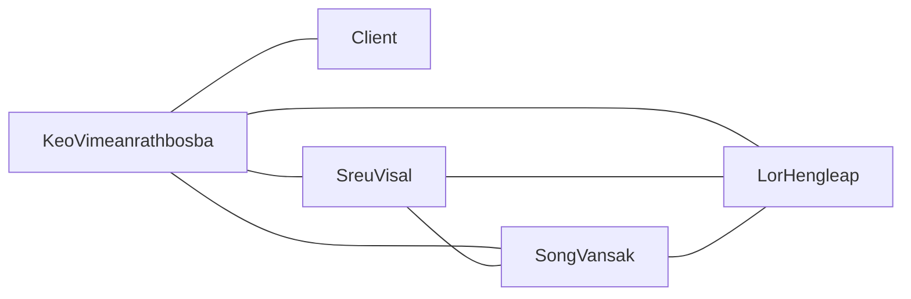

# Communication overhead · clubhub-ITC-4G (v1.0, 2026--)

## Paths

| Model                 | People n | Paths n(n-1)/2    | Minutes/week | Hours/week |
| --------------------- | -------- | ----------------- | ------------ | ---------- |
| (a) everyone + client | 6        | 6(6-1)/2=15       | 15x10 = 150  | 2.5        |
| (b) client via PO     | 6        | 5(5-1)/2 + 1 = 11 | 11x10 = 110  | 1.83       |

Assumption: 10 minutes per path per week, because each communication path requires time to exchange updates, clarify requirements, and resolve misunderstandings.
Team capacity: 5 members × 2 h = 10 h/week → model (b) costs 1.83 / 10 × 100 = 18.3% of weekly team capacity.

## Our paths (model b)

## Two practices
1. ...   new overhead: __ h/week
2. ...  

## A sixth member in week 11?

## Reflection: the essential difficulty we expect first
- (signed) ...