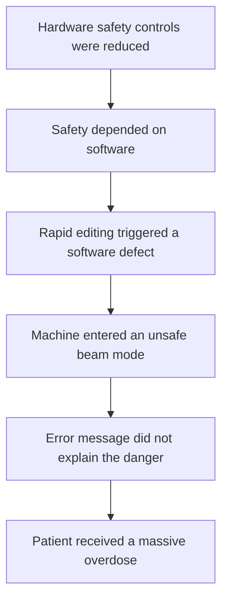

# Failure case analysis ·Therac-25 (v1.0, 2026-__-__)
| Authors             | Section |
| ------------------- | ------- |
| Keo Vimeanrathbosba | 1-2     |
| Song Vansak         | 3-4     |
| Lor Hengleap        | 5-6     |
| Sreu Visal          | 7       |
 
## 1. Context
Therac-25 was a computer-controlled medical linear accelerator manufactured by Atomic Energy of Canada Limited. Hospitals used the machine to treat cancer by directing high-energy electron or X-ray beams at tumors.

Medical staff entered the prescribed treatment mode, energy, and dose through a computer terminal. Software then controlled and monitored the machine. Unlike the earlier Therac-6 and Therac-20 machines, Therac-25 depended more heavily on software for safety. Several independent hardware interlocks used in the earlier machines were not retained.
## 2. Timeline
| Date         | Event                                                                             |
|22 March 1983 | The U.S. Food and Drug Administration determined that Therac-25 was substantially
equivalent to an existing radiation-therapy device through the 510(k) process.
|3 June 1985   | A patient at Kennestone Regional Oncology Center in Marietta, Georgia received a massive radiation overdose during an electron treatment. The connection between the injury and Therac-25 was not initially accepted or thoroughly investigated.
|26 July 1985  | A patient at the Ontario Cancer Foundation in Hamilton, Ontario, received an overdose after the machine repeatedly displayed an “H-tilt” error and indicated that no dose had been delivered.
|21 March 1986 | A patient at the East Texas Cancer Center in Tyler, Texas, received a massive overdose. Investigators initially could not reproduce the malfunction.
|11 April 1986 | A second patient at the East Texas Cancer Center received an overdose. The hospital physicist and operator reproduced the sequence that triggered the failure, allowing the software problem to be investigated.
|15 April 1986 | Atomic Energy of Canada Limited submitted a medical-device report to the FDA covering the two Tyler accidents.
|17 January 1987| Another overdose occurred at Yakima Valley Memorial Hospital. In February 1987, regulators required routine use of Therac-25 to stop until permanent corrective modifications were implemented.
## 3. What failed
Therac-25 depended heavily on software instead of independent hardware safety
controls. Certain fast changes made by an operator could leave the software in
an unsafe state. Unclear error messages then allowed the operator to continue
treatment without knowing that the patient had received dangerous radiation.

## 4. Root causes

| Root cause                                   | Type           | Difficulty   | Justification                                                               |
| -------------------------------------------- | -------------- | ------------ | --------------------------------------------------------------------------- |
| Unsafe shared data and timing behavior       | Technical      | Complexity   | Several software tasks interacted in ways that were difficult to predict.   |
| Insufficient testing of rapid operator input | Process        | Invisibility | The defect appeared only during a particular sequence and timing of inputs. |
| Independent hardware interlocks were reduced | Organisational | Accidental   | An independent safety layer could have stopped the unsafe radiation beam.   |

## 5. Practices that would have prevented or limited it

| Root cause                                   | Type           | Difficulty   | Justification                                                               |
| -------------------------------------------- | -------------- | ------------ | --------------------------------------------------------------------------- |
| Unsafe shared data and timing behavior       | Technical      | Complexity   | Several software tasks interacted in ways that were difficult to predict.   |
| Insufficient testing of rapid operator input | Process        | Invisibility | The defect appeared only during a particular sequence and timing of inputs. |
| Independent hardware interlocks were reduced | Organisational | Accidental   | An independent safety layer could have stopped the unsafe radiation beam.   |

## 6. Lessons for ITC Club Hub

1. The CSV importer will reject capacity unless the value is a whole number
   from 1 to 500 and will display the invalid row and value.
2. Every change must pass automated tests and receive approval from another
   team member before it can be merged into main.

## 7. Sources

1. Author/Organization: U.S. Food and Drug Administration  
   Title: “510(k) Premarket Notification: Therac 25 Linear Accelerator (K837152)”  
   Year: 1983  
   URL: View the FDA Therac-25 record (https://www.accessdata.fda.gov/scripts/cdrh/cfdocs/cfpmn/pmn.cfm?ID=k837152)

2. Authors: Nancy G. Leveson and Clark S. Turner  
   Title: “An Investigation of the Therac-25 Accidents”  
   Year: 1993  
   URL: Read the Therac-25 investigation (https://web.mit.edu/6.033/2004/wwwdocs/papers/Therac_1.html)

3. Author: Charles Huff  
   Title: “References for Therac-25 Case”  
   Year: 2003  
   URL: View the Therac-25 case references (https://onlineethics.virginia.edu/cases/therac-25/references-therac-25-case)