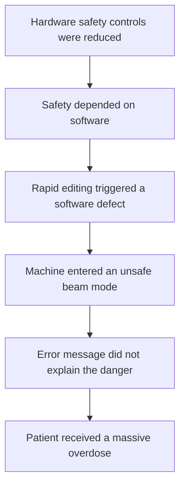

# Failure case analysis ·Therac-25 (v1.0, 2026-__-__)
| Authors             | Section |
| ------------------- | ------- |
| Keo Vimeanrathbosba | 1-2     |
| Song Vansak         | 3-4     |
| Lor Hengleap        | 5-6     |
| Sreu Visal          | 7       |
 
## 1. Context
## 2. Timeline

## 3. What failed
Therac-25 depended heavily on software instead of independent hardware safety
controls. Certain fast changes made by an operator could leave the software in
an unsafe state. Unclear error messages then allowed the operator to continue
treatment without knowing that the patient had received dangerous radiation.

## 4. Root causes

| Root cause                                   | Type           | Difficulty   | Justification                                                               |
| -------------------------------------------- | -------------- | ------------ | --------------------------------------------------------------------------- |
| Unsafe shared data and timing behavior       | Technical      | Complexity   | Several software tasks interacted in ways that were difficult to predict.   |
| Insufficient testing of rapid operator input | Process        | Invisibility | The defect appeared only during a particular sequence and timing of inputs. |
| Independent hardware interlocks were reduced | Organisational | Accidental   | An independent safety layer could have stopped the unsafe radiation beam.   |

## 5. Practices that would have prevented or limited it

| Root cause                                   | Type           | Difficulty   | Justification                                                               |
| -------------------------------------------- | -------------- | ------------ | --------------------------------------------------------------------------- |
| Unsafe shared data and timing behavior       | Technical      | Complexity   | Several software tasks interacted in ways that were difficult to predict.   |
| Insufficient testing of rapid operator input | Process        | Invisibility | The defect appeared only during a particular sequence and timing of inputs. |
| Independent hardware interlocks were reduced | Organisational | Accidental   | An independent safety layer could have stopped the unsafe radiation beam.   |

## 6. Lessons for ITC Club Hub

1. The CSV importer will reject capacity unless the value is a whole number
   from 1 to 500 and will display the invalid row and value.
2. Every change must pass automated tests and receive approval from another
   team member before it can be merged into main.

## 7. Sources
1. <author or organisation, title, year, URL> (primary)