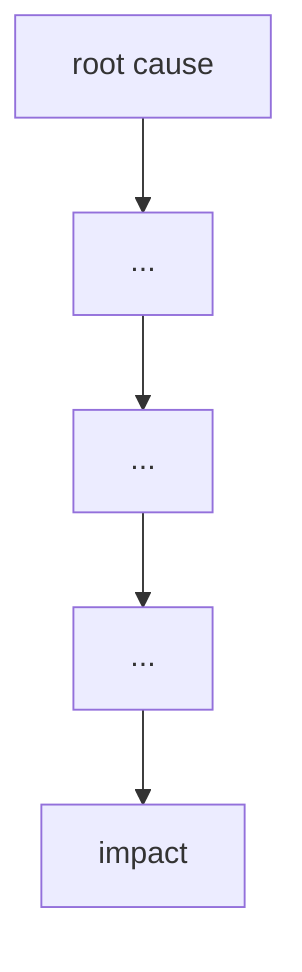

# Failure case analysis · <case> (v1.0, 2026-__-__)
Authors: <member per section>

## 1. Context
Therac-25 was a computer-controlled medical linear accelerator manufactured by Atomic Energy of Canada Limited. Hospitals used the machine to treat cancer by directing high-energy electron or X-ray beams at tumors.

Medical staff entered the prescribed treatment mode, energy, and dose through a computer terminal. Software then controlled and monitored the machine. Unlike the earlier Therac-6 and Therac-20 machines, Therac-25 depended more heavily on software for safety. Several independent hardware interlocks used in the earlier machines were not retained.
## 2. Timeline
| Date         | Event                                                                             |
|22 March 1983 | The U.S. Food and Drug Administration determined that Therac-25 was substantially
equivalent to an existing radiation-therapy device through the 510(k) process.
|3 June 1985   | A patient at Kennestone Regional Oncology Center in Marietta, Georgia received a massive radiation overdose during an electron treatment. The connection between the injury and Therac-25 was not initially accepted or thoroughly investigated.
|26 July 1985  | A patient at the Ontario Cancer Foundation in Hamilton, Ontario, received an overdose after the machine repeatedly displayed an “H-tilt” error and indicated that no dose had been delivered.
|21 March 1986 | A patient at the East Texas Cancer Center in Tyler, Texas, received a massive overdose. Investigators initially could not reproduce the malfunction.
|11 April 1986 | A second patient at the East Texas Cancer Center received an overdose. The hospital physicist and operator reproduced the sequence that triggered the failure, allowing the software problem to be investigated.
|15 April 1986 | Atomic Energy of Canada Limited submitted a medical-device report to the FDA covering the two Tyler accidents.
|17 January 1987| Another overdose occurred at Yakima Valley Memorial Hospital. In February 1987, regulators required routine use of Therac-25 to stop until permanent corrective modifications were implemented.
## 3. What failed
<one paragraph>

## 4. Root causes
| # | Root cause | Type | Essential difficulty | Why |
|---|------------|------|----------------------|-----|
| R1 |           | technical / process / organisational | | |

## 5. Practices that would have prevented or limited it
| Root cause | Practice | Chapter |
|------------|----------|---------|

## 6. Lessons for ITC Club Hub
1.
2.

## 7. Sources
1. <author or organisation, title, year, URL> (primary)