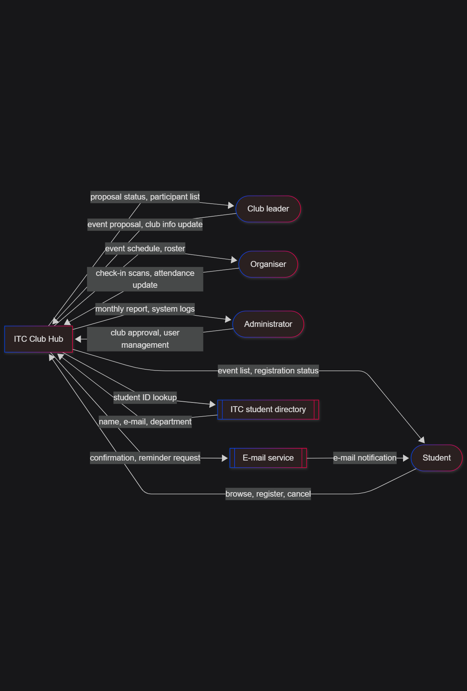

# Lab 02: ITC Club Hub — Architecture, Quality Scenarios & Core Domain Model

**Version:** 1.0  
**Date:** 2026-11-03  
**Team:** clubhub-ISE-4G  

---

## Lab Overview & Objectives
This repository contains the complete deliverables for **Lab 02**, focusing on software application classification, architectural decision-making via ADRs, quality attribute scenarios (QAS), system context modeling, three-tier architectural sketching, the C++20 domain model implementation for **ITC Club Hub**, and the offline-first check-in challenge.

---

## 1. System Architecture & Visual Diagrams

### System Context Diagram
The context diagram frames **ITC Club Hub** as a central system block interacting with four human roles (*Student, Club leader, Organiser, Administrator*) and two external systems (*E-mail service, ITC student directory*), capturing all core data flows.



### Three-Tier Architecture Sketch
The three-tier sketch decomposes the application into **Presentation**, **Logic**, and **Data** tiers. It distinguishes between implemented C++ components (such as the CLI front end, domain logic services, and CSV storage) and modelled front ends (such as the web PWA from ADR-001), while routing external communications correctly through the logic tier.


---

## 2. Summary of Lab Tasks & Deliverables

### Task 1: Application Classification (`app-classification.md`, `app-quadrant.mmd`)
* Classified five real-world applications using standard software engineering vocabulary and charted them on a quadrant graph.

### Task 2: Application Type Decision (`adr-001-application-type.md`)
* Evaluated user groups and weighted options, selecting **Option B (PWA + responsive web app)** with an offline check-in queue to satisfy venue connectivity requirements.

### Task 3: Quality Attribute Scenarios (`quality-scenarios.md`)
* Developed six comprehensive six-part quality attribute scenarios (QAS-01 to QAS-06) with prioritized trade-offs.

### Task 4: Context & Three-Tier Diagrams (`context-diagram.mmd`, `architecture.mmd`)
* Mapped out system boundaries and component layers with explicit folder mappings and exported rendered PNG assets.

### Task 5: C++ Core & CLI Interface (`src/event.cpp`, `src/event_csv.cpp`, `src/cli/main.cpp`)
* Implemented the decoupled C++20 domain model (`Event` class with `std::chrono` precision), robust CSV parser (`loadEventsCsv`), and CLI front end (`list-events`).

### Challenge: Offline-First Check-In (`challenge/offline-checkin.md`, `include/clubhub/queued_checkin.hpp`)
* Designed a local IndexedDB sync queue, a sequence diagram for offline scans, a conflict resolution rules table, and an idempotent C++ check-in data structure.

---

## 3. Comprehensive File Inventory

| File Path                           | Description                                                                              | Main Author              |
| :---------------------------------- | :--------------------------------------------------------------------------------------- | :----------------------- |
| `lab02/app-classification.md`       | Classification and analysis of five everyday applications using chapter vocabulary       | Everyone                 |
| `lab02/app-quadrant.mmd`            | Mermaid quadrant chart charting applications by timing vs. availability demands          | Everyone                 |
| `lab02/adr-001-application-type.md` | Architecture Decision Record selecting the PWA/web hybrid approach via weighted criteria | Product Owner / Everyone |
| `lab02/quality-scenarios.md`        | Six complete quality attribute scenarios (QAS-01 to QAS-06) with prioritized trade-offs  | Scrum Master / Everyone  |
| `lab02/context-diagram.mmd`         | Mermaid source for the system context diagram                                            | Lor Hengleap             |
| `lab02/context-diagram.png`         | Exported image of the system context diagram                                             | Lor Hengleap             |
| `lab02/architecture.mmd`            | Mermaid source for the three-tier architecture sketch                                    | Lor Hengleap             |
| `lab02/architecture.png`            | Exported image of the three-tier architecture sketch                                     | Lor Hengleap             |
| `include/clubhub/event.hpp`         | Core Event class definition, time point types, and parsing declarations                  | Given                    |
| `include/clubhub/event_csv.hpp`     | CSV parser interface structures (`CsvError`, `EventLoadResult`)                          | Given                    |
| `src/event.cpp`                     | Event validation rules and strict ISO/local date-time string parsing/formatting          | Lor Hengleap             |
| `src/event_csv.cpp`                 | Robust line-by-line CSV parser with error recovery and line numbering                    | Lor Hengleap             |
| `src/cli/main.cpp`                  | Thin command-line interface handling sorting, console output, and errors                 | Lor Hengleap             |
| `CMakeLists.txt`                    | Build configuration defining `clubhub_core` library and `clubhub` executable             | Given                    |
| `data/events.csv`                   | Sample event dataset including valid records and intentional error row (`E004`)          | Given                    |
| `lab02/README.md`                   | Laboratory documentation, inventories, reuse logs, and change history                    | Lor Hengleap             |

---

---

## 4. Inputs Reused from Lab-01

| Reused File             | Commit Hash / Version | Purpose in Lab-02                                                                                                        |
| :---------------------- | :-------------------- | :----------------------------------------------------------------------------------------------------------------------- |
| `lab01/team-charter.md` | `3f8e2a1`             | Defines team collaboration roles, task-sharing, consensus decision rules, and peer-review workflow guidelines.           |
| `lab01/decisions.md`    | `7c4b1d9`             | Houses Architecture Decision Records (ADR-001) specifying web PWA/front-end choices referenced in the presentation tier. |

---

## 5. Build and Execution Instructions

To compile and run the C++ core and CLI executable from a clean repository clone:

```bash
# Configure the build directory using CMake 3.28 or later
cmake -S . -B build

# Build the project targets (clubhub_core library and clubhub executable)
cmake --build build

# Run the list-events command using the sample dataset
./build/clubhub list-events data/events.csv
```

---

## 6. Change Log

| Date       | Version | Description                                                                                                                                                                                                                                                                                                                                                                                                      | Author   |
| :--------- | :------ | :--------------------------------------------------------------------------------------------------------------------------------------------------------------------------------------------------------------------------------------------------------------------------------------------------------------------------------------------------------------------------------------------------------------- | :------- |
| 2026-11-03 | 1.0     | Initial release: Complete classification table and quadrant chart, ADR-001 application type decision record, six prioritized QAS scenarios, context and architecture diagrams with PNG exports, offline-first check-in challenge documentation (`offline-checkin.md` and `queued_checkin.hpp`), decoupled C++20 event core library, list-events CLI, sample CSV dataset, and comprehensive README documentation. | Everyone |