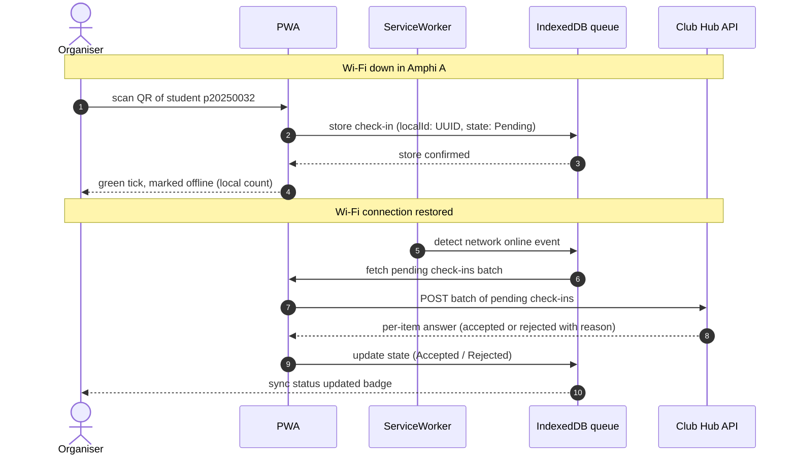

# Challenge: Offline-First Check-In for Debate Night (Amphi A)

Version: 1.0 · Date: 2026-11-03 · Team: clubhub-ISE-4G

---

## 1. Sequence Diagram: Offline Check-In and Synchronisation

---

## 2. Conflict Rules Table

| #   | Case                                                        | Winner                                               | Organiser sees                                                                                                   | Stored on the server                                                                                                                      |
| --- | ----------------------------------------------------------- | ---------------------------------------------------- | ---------------------------------------------------------------------------------------------------------------- | ----------------------------------------------------------------------------------------------------------------------------------------- |
| 1   | Same student scanned at both doors (Door 1 & Door 2)        | First recorded scan (by timestamp or server arrival) | Green tick on both phones locally; upon sync, second phone receives "already checked in" warning.                | First check-in record marked `CheckedIn`; second returns `Rejected` ("Duplicate check-in").                                               |
| 2   | Registration cancelled on the server before the scan synced | Server cancellation status                           | Green tick locally at scan time; later sync shows warning "Registration was cancelled".                          | Check-in rejected; attendance not counted.                                                                                                |
| 3   | Student not registered at all                               | Server state (Not Registered)                        | Green tick locally (offline assumption); upon sync, organiser sees red error "Student not registered for event". | Check-in rejected; optional flag created for manual organiser review.                                                                     |
| 4   | Upload retried after a timeout, server had applied it       | Server (first copy)                                  | Nothing new (seamless confirmation).                                                                             | Server keeps a set of applied `localId` keys; second POST with the same `localId` returns `Accepted` without creating a duplicate record. |
| 5   | Phone clock 7 minutes wrong                                 | Server relative sequence / adjusted window           | Local check-in succeeds; server accepts if within valid event attendance time window despite minor skew.         | Stored with server-adjusted receipt timestamp or device timestamp with skew flag.                                                         |

---

## 3. Idempotency Key Explanation

The `localId` field in `QueuedCheckIn` is a **UUID (Universally Unique Identifier)** generated locally on the device at the exact moment of the scan. 
* **Why it makes retries idempotent:** If a batch upload times out or drops mid-transmission, the PWA will safely retry sending the same batch. Because every check-in carries its unique `localId`, the server checks whether that `localId` has already been processed and saved. If it has, the server returns `Accepted` immediately without re-inserting or duplicating the attendance record.

---

## 4. Link to Quality Attributes & Trade-Offs

### Impact on Existing Scenarios (QAS-01 to QAS-06)
* **Improved — QAS-01 (Availability):** Local caching and queuing prevent server connection drops from halting door operations, ensuring 100% availability for door check-ins during Wi-Fi outages.
* **Improved — QAS-02 (Check-in Performance):** Local IndexedDB writes take $\le 50\text{ ms}$, effortlessly handling the rush of 200 arrivals in 10 minutes without network blocking.
* **Made Harder — QAS-04 (Security & Consistency):** Storing attendance data locally and handling offline validation introduces synchronization conflicts, requiring robust idempotency and state resolution.

### New Quality Attribute Scenario: QAS-07 (Offline-First Outage Resilience)
| Part                 | Content                                                                                                                                                                                   |
| -------------------- | ----------------------------------------------------------------------------------------------------------------------------------------------------------------------------------------- |
| **Source**           | Club event organiser at Amphi A door                                                                                                                                                      |
| **Stimulus**         | Venue Wi-Fi drops completely for a 5-minute interval during a peak arrival surge (100 students entering)                                                                                  |
| **Environment**      | Amphi A entrance, zero Wi-Fi connectivity, 2 doors operating simultaneously                                                                                                               |
| **Artifact**         | PWA client app, ServiceWorker, and IndexedDB local check-in queue                                                                                                                         |
| **Response**         | PWA records all scans locally with zero blocking delay, displays immediate green confirmation ticks, and automatically synchronises queued records within 15 seconds of Wi-Fi restoration |
| **Response measure** | 0 missed student arrivals; 100% sync success rate after reconnection with zero duplicate records stored                                                                                   |