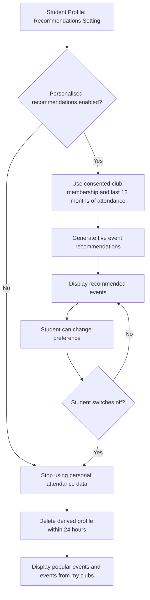

# AI feature proposal: "Recommended for you"
Version 0.1 · 2026-MM-DD · Authors: Song Vansak

## 1 Problem and non-personalised baseline
## 2 Data needed
| Field | Source | In inventory? | New purpose / consent? | Minimisation |
| ----- | ------ | ------------- | ---------------------- | ------------ |
## 3 Bias risks
| Risk | Who is harmed | Mitigation | Fairness check (metric, threshold) |
| ---- | ------------- | ---------- | ---------------------------------- |
## 4 Transparency
### Example: "Why am I seeing this?"

Event: University Photography Workshop

Why am I seeing this?

This event is recommended because:

- You previously attended photography-related club activities.
- You are a member of the Photography Club.
- The workshop is an upcoming event you have not attended before.

We use your club memberships and attendance from the last 12 months to suggest relevant events.

You can change your recommendation preferences or switch off personalised recommendations at any time in your profile settings.

### Ranking Inputs Published by the Clubs Office

The Clubs Office will publish the main ranking factors:

1. Previous attendance.
2. Club membership.
3. Upcoming event availability.
4. Event diversity.
5. Overall event popularity.

These factors explain how the system selects and ranks the five recommended events.
## 5 Opt-out design
### Default Setting: Opt-in (Off by Default)

Personalised recommendations should be off by default because the system uses students' personal attendance history and club membership information.

Students must actively agree before the system creates a personalised recommendation profile.

### Where the Switch Lives

Student Profile → Privacy Settings → Personalised Recommendations

Students can:

- Turn on personalised recommendations.
- Turn off personalised recommendations.
- Continue using non-personalised recommendations.
- View information about how their data is used.

### What Happens When Students Switch It Off?

1. The system immediately stops using attendance history for recommendations.
2. The derived recommendation profile is deleted within 24 hours.
3. Original attendance and club membership records remain in university systems for their normal purposes.
4. The student continues seeing popular events and events from their clubs.
5. The student can opt in again at any time.
### Mermaid Flowchart

## 6 Recommendation
Decision: GO WITH CONDITIONS

The "Recommended for You" feature should be developed in Sprint 2, but only after the non-personalised baseline has been available for one month.

### Conditions

1. Opt-in by default: Personalised recommendations must be off by default. Switching off must delete the derived student profile within 24 hours.

2. Limited data collection: Only use attendance from the last 12 months and club memberships. Do not use phone numbers, emails or free-text information.

3. Event diversity: At least 2 of the 5 recommendation slots must show events from clubs the student has never attended.

4. Small club fairness: Clubs with fewer than 20 members must receive at least 80% of their fair share of recommendations compared with their share of eligible events.

5. Transparency: Students must understand why events are recommended and how their data is used.

6. Fairness monitoring: The system must be checked every month. If fairness requirements are not achieved, the recommendation rules must be adjusted.

### Owner of the Fairness Check

The Clubs Office will be responsible for monitoring fairness after release.

The Clubs Office will:

- Review recommendation results every month.
- Check whether small clubs receive fair exposure.
- Monitor opportunities for new students.
- Investigate unfair recommendation patterns.
- Report problems and recommend improvements.

### Final Conclusion

The "Recommended for You" feature can help students discover activities that match their interests. However, personalisation also creates privacy, transparency and fairness risks.

Therefore, the project should receive conditional approval. The university should first establish a non-personalised baseline, obtain student consent, minimise personal data collection and conduct regular fairness checks.

If these conditions are satisfied, the feature can be introduced responsibly while ensuring fair opportunities for all students and clubs.