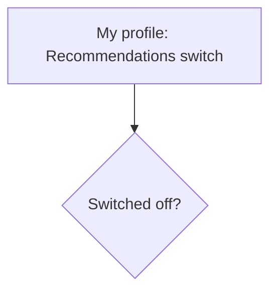

# AI feature proposal: "Recommended for you"
Version 0.1 · 2026-MM-DD · Authors: <names>

## 1 Problem and non-personalised baseline
## 2 Data needed
| Field | Source | In inventory? | New purpose / consent? | Minimisation |
|-------|--------|---------------|------------------------|--------------|
## 3 Bias risks
| Risk | Who is harmed | Mitigation | Fairness check (metric, threshold) |
|------|---------------|------------|------------------------------------|
## 4 Transparency
"Why am I seeing this?" example: TODO
## 5 Opt-out design

## 6 Recommendation
Decision: GO / NO-GO / GO WITH CONDITIONS
Conditions: TODO · Owner of the fairness check: TODO