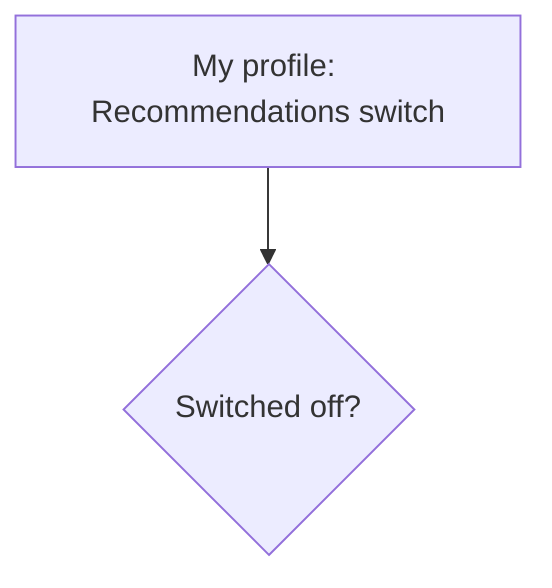

# AI feature proposal: "Recommended for you"
Version 0.1 · 2026-11-18 · Authors: <Keo Vimeanrathbosba>

## 1 Problem and non-personalised baseline
The User problem
Students on campus everywhere are facing severe information overload because of the amount of club events, and school events shared daily on the Clubhub portal. Since there is too much information, students tend to overlook or miss the actual important events or opportunities that align with their interest.

The Non-personalised Baseline
Before introducing machine learning or behavioral tracking, we establish a robust, privacy-preserving baseline combining two simple rules:

"Popular This Week": Displays the top 5 most-booked campus-wide events based on total confirmed RSVPs in the current week.

"Events of My Clubs": Displays upcoming events exclusively from clubs where the student is an official registered member.

Why this matters: This baseline solves 60% of the discovery problem (trending campus life and enrolled club updates) instantly, predictably, and transparently without collecting behavioral history or creating personal recommendation profiles. Any proposed AI feature must justify its added complexity over this baseline.
## 2 Data needed
| Field | Source | In inventory? | New purpose / consent? | Minimisation |
| Event ID / Title / Date | Events Table | Yes | No (Core feature) | None |
| Club ID / Category | Club Table | Yes | No (Core feature) | None |
| User Attendance History | Attendance Logs | 
## 3 Bias risks
| Risk | Who is harmed | Mitigation | Fairness check (metric, threshold) |
|------|---------------|------------|------------------------------------|
## 4 Transparency
"Why am I seeing this?" example: TODO
## 5 Opt-out design

## 6 Recommendation
Decision: GO / NO-GO / GO WITH CONDITIONS
Conditions: TODO · Owner of the fairness check: TODO