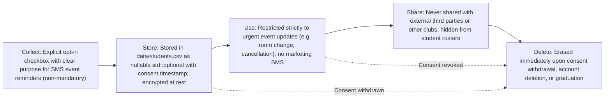

# Data inventory · ITC Club Hub
Version 0.1 · 2026-11-11 · Authors: Keo Vimeanrathbosba, Song Vansak, Lor Hengleap, Sreu Visal

| Field           | Subject | Purpose                                                                        | Legal basis / consent                                                                                                     | Retention                                                                           | Who can see it                                                                                                     | Stored in                    | Decision                                                                                                                             |
| --------------- | ------- | ------------------------------------------------------------------------------ | ------------------------------------------------------------------------------------------------------------------------- | ----------------------------------------------------------------------------------- | ------------------------------------------------------------------------------------------------------------------ | ---------------------------- | ------------------------------------------------------------------------------------------------------------------------------------ |
| studentId       | student | Login screen, duplicate membership block rule, profile header                  | Necessary for the service: Required to uniquely verify university enrollment and prevent duplicate registrations.         | Until graduation or 1 year after account deactivation.                              | Student (own full ID), Administrator (full ID), Organiser (masked: e2******7), Club Leader (masked: e2******7)     | data/students.csv            | Mask: Stored in full for duplicate prevention, but masked as e2******7 for event organisers and in logs to prevent student tracking. |
| name            | student | Event check-in sheet, club member roster screen, personalized notifications    | Necessary for the service: Required to address the member and verify student identity at physical club events.            | Until graduation or 1 year after account deletion request.                          | Student (own), Organiser, Club Leader, Administrator                                                               | data/students.csv            | Keep: Essential for identification on club rosters and event attendance rolls.                                                       |
| email           | student | Account authentication, registration confirmation screen, booking receipts     | Necessary for the service: Essential for primary communication, account recovery, and event booking confirmations.        | Until account deletion or graduation.                                               | Student (own), Administrator; Club Leader (registered members only)                                                | data/students.csv            | Keep: Required primary channel for account verification and official club notifications.                                             |
| phone           | student | Urgent SMS event alerts (room changes, cancellations) on event dispatch screen | Consent (opt-in): Collected only when the student explicitly ticks an SMS reminder consent checkbox.                      | Until consent is withdrawn by the student or account deletion.                      | Student (own), Administrator; Organiser / Club Leader (emergency alert broadcast only, never visible in cleartext) | data/students.csv            | Keep optional: Stored only upon explicit opt-in consent and erased immediately when consent is withdrawn.                            |
| clubMemberships | student | Student dashboard ("My Clubs"), club roster screen, membership validation rule | Necessary for the service: Required to track club affiliations, calculate club quotas, and grant member privileges.       | Until student leaves the club, graduation, or club dissolution.                     | Student (own), Club Leader (own club roster), Administrator (all clubs)                                            | data/memberships.csv         | Keep: Core functional requirement to track which student belongs to which club.                                                      |
| attendance      | student | Event check-in screen, club activity audit report, venue capacity rules        | Legitimate interest: Club organizers require attendance records to evaluate event success and plan future venue capacity. | Individual records kept until the end of active academic semester, then aggregated. | Student (own history), Organiser / Club Leader (own events), Administrator (audit)                                 | data/registrations.csv       | Aggregate: Kept individually during active semester, then aggregated into club attendance counts and individual records purged.      |
| dateOfBirth     | student | Candidate field: Proposed for birthday greetings and age-verification screen   | Consent / None: No legitimate basis; club participation does not have statutory age limits.                               | Immediately dropped / never stored.                                                 | None                                                                                                               | Not stored                   | Drop: Dropped because Club Hub events do not require age verification, avoiding the risk of holding high-value identity theft data.  |
| photo           | student | Candidate field: Proposed for member directory profile card / avatar           | Consent / None: No legitimate basis; physical student identity cards are checked at event doors.                          | Immediately dropped / never stored.                                                 | None                                                                                                               | Not stored                   | Drop: Dropped to eliminate biometric photo storage and minimize surveillance and profiling risks.                                    |
| facultyAndYear  | student | Candidate field: Proposed for annual club demographic report                   | Legitimate interest: Clubs seek high-level demographic breakdown for workshop planning.                                   | Retained only until annual report compilation, then individual linkage deleted.     | Student (own profile), Club Leader / Administrator (aggregated demographic summary only)                           | data/surveys.csv (temporary) | Aggregate: Collected optionally and aggregated into department-level statistics, discarding individual student links.                |
| gender          | student | Candidate field: Proposed for demographic diversity reporting on dashboard     | Consent / None: No legitimate basis; all clubs are open and non-discriminatory.                                           | Immediately dropped / never stored.                                                 | None                                                                                                               | Not stored                   | Drop: Dropped because club access is open to all students and collecting gender creates discrimination risks.                        |
| telegramHandle  | student | Candidate field: Proposed for informal event group chat invitations            | Consent / None: No legitimate basis; unmonitored external messaging bypasses university safeguards.                       | Immediately dropped / never stored.                                                 | None                                                                                                               | Not stored                   | Drop: Dropped to keep communications within secure institutional email and SMS channels without third-party data liabilities.        |

## Copies of personal data
| Copy                | Rule                                                                                                                                                                                   |
| ------------------- | -------------------------------------------------------------------------------------------------------------------------------------------------------------------------------------- |
| log files           | Only `redacted()` output (e.g. `Student{id=e2******7}`), never output student name, raw email address, or phone number.                                                                |
| CSV exports         | Restricted to authenticated administrators and club leaders; exports must mask studentId (`e2******7`), omit unconsented phone numbers, encrypt at rest, and auto-delete after 7 days. |
| test fixtures       | Strictly synthetic mock data only (e.g. dummy ID `e20990417`, fake names, `@example.edu` emails); never copy real student records into test suites.                                    |
| backups             | Encrypted at rest (AES-256), access-restricted to system administrators, isolated from web access, and purged on a 30-day rolling retention cycle matching deletion requests.          |
| screenshots in docs | Must use synthetic demo data only (e.g. "Test Student", dummy ID `e20990001`); any accidental personal data must be permanently blurred or replaced before committing.                 |

## Lifecycle of the phone field

## Client feedback
- **Session:** Product Owner (Keo Vimeanrathbosba) walked the Teaching Assistant (acting client) through the Data Inventory and Drop decisions (5-minute review, 2026-11-11).
- **Reviewed Drop decisions:**
  1. `dateOfBirth`: Dropped. Rationale: No legal or operational age verification required for on-campus clubs; collecting birth dates introduces identity theft exposure.
  2. `photo`: Dropped. Rationale: Physical student ID cards suffice for in-person check-in; storing portrait photos introduces biometric privacy risks.
  3. `gender`: Dropped. Rationale: Clubs are open to all students; storing gender risks discrimination without operational necessity.
  4. `telegramHandle`: Dropped. Rationale: External messaging apps bypass university auditability and introduce third-party privacy vulnerabilities; official email and opt-in SMS suffice.
- **Client questions & objections:**
  - *Objection 1 (Off-campus trips & insurance):* The TA asked whether clubs participating in external events or off-campus trips need date of birth or emergency contact details.
    - *PO Resolution:* Off-campus activities and insurance coverage are administered directly by the University Student Affairs / Faculty Dean's office through official university paper/central channels. Club Hub's scope is strictly on-campus club membership, event discovery, and registrations.
  - *Objection 2 (Telegram popularity):* The TA noted that Telegram is the predominant communication tool among Cambodian students and asked if dropping it reduces engagement.
    - *PO Resolution:* Club organizers can post public Telegram channel invite links in public event descriptions. Storing individual student handles in the Club Hub database creates scraping risks and compliance liabilities. In-app event notices and SMS remain the official channels.
- **Client sign-off:** The TA accepted the justifications, commended the strict adherence to GDPR Article 5(1)(c) data minimisation, and approved all Drop, Mask, and Aggregate decisions for implementation in Task 2.
