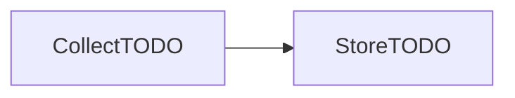

# Data inventory · ITC Club Hub
Version 0.1 · 2026-MM-DD · Authors: <names>

| Field | Subject | Purpose | Legal basis / consent | Retention | Who can see it | Stored in | Decision |
|-------|---------|---------|-----------------------|-----------|----------------|-----------|----------|
| studentId | student | identify; block double registration | necessary for the service | TODO | TODO | data/students.csv | Mask for organisers: TODO reason |
| name | student | TODO | TODO | TODO | TODO | TODO | TODO |
| phone | student | TODO | consent (opt-in) | TODO | TODO | TODO | TODO |
| attendance | student | TODO | legitimate interest: TODO why | TODO | TODO | data/registrations.csv | TODO |
| dateOfBirth | student | TODO: is there any? | TODO | TODO | TODO | TODO | TODO |

## Copies of personal data
| Copy | Rule |
|------|------|
| log files | only `redacted()` output, never name, email or phone |
| CSV exports | TODO |
| test fixtures | TODO |
| backups | TODO |
| screenshots in docs | TODO |

## Lifecycle of the phone field

## Client feedback
- TODO